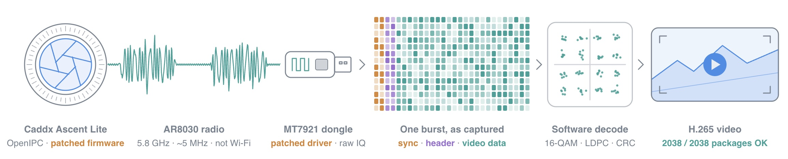

# AR8030 Decoder
This is a work in progress decoder for the AR8030 chip.
At the moment it is able to decode a video from a Caddax ascent lite + running open IPC.

### Setup
The Caddax ascent lite + is flashed with Open IPC and the fw modified to force vidoe streaming without being bound.
[Mtk79ICAP](https://github.com/MtkWifiRev/Mtk79ICAP/tree/master) was used as the SDR with a small modification needed to fix the gain control that was miss detecting on the AD8030.
The air format itself (OFDM, FEC, package and stream layout) is described in [docs/AR8030_Airformat.md](docs/AR8030_Airformat.md).   
Opus 5.5 was used to decipher the protocal and Kimi3.1 was used to modify the AR8030 FW.  




### 1. OpenIPC on the Ascent Lite

The VTX runs OpenIPC built from the `ascent` branch of [henkwiedig/builder](https://github.com/henkwiedig/builder/tree/ascent) (device `hi3516cv6xx_artosyn_caddx-ascent-lite`). It includes [ar8030-transport](https://github.com/henkwiedig/ar8030-transport), which sends the video over the AR8030, and [waybeam_venc](https://github.com/henkwiedig/waybeam_venc), the encoder.

- **Prebuilt image:** [nightly-bisect-9f3ef6f](https://github.com/henkwiedig/builder/releases/tag/nightly-bisect-9f3ef6f-20261029204225) (`Ascent_H_Sky_18_21_10_OpenIPC.img`). Use this build: the unpaired-TX patch below only accepts the AR8030 baseband image shipped with builder `9f3ef6f`.
- **Or build it:** `git clone -b ascent https://github.com/henkwiedig/builder && cd builder && ./builder.sh hi3516cv6xx_artosyn_caddx-ascent-lite`

**Install** with [`usbburn.py`](https://github.com/henkwiedig/builder/blob/ascent/devices/hi3516cv6xx_artosyn_caddx-ascent-lite/scripts/usbburn.py) over USB, no serial adapter needed. It needs `pyusb` and a udev rule (see `usbburn.py --help`). Hold the bind button while powering on and keep holding it. Back up first, and put OpenIPC on bank 1 so the stock firmware stays on bank 0:

```sh
usbburn.py dump all -o backup/
usbburn.py flash --bank 1 --asw Ascent_H_Sky_18_21_10_OpenIPC.img --select --boot
usbburn.py select 0      # later: boot stock again
```

The device comes up as a USB network gadget at `192.168.3.104` (ssh `root`).

### 2. Transmit without pairing

Stock firmware only sends user data once a ground unit has paired. Two changes on the VTX make it transmit on its own.

**Patch the baseband image** with [patches/patch-ar8030-unpaired-v3.py](patches/patch-ar8030-unpaired-v3.py). The AR8030 only drains the host's video socket once its slot is marked connected, and only a real pair event does that. The patch adds a small hook to the TX task that sends the "slot 0 connected" message itself. The script checks the input md5 and refuses any image other than the `9f3ef6f` one.

```sh
scp -O root@192.168.3.104:/lib/firmware/ar8030/ar8030.img ar8030.img
python3 patches/patch-ar8030-unpaired-v3.py ar8030.img ar8030-unpaired.img
ssh root@192.168.3.104 cp /lib/firmware/ar8030/ar8030.img /lib/firmware/ar8030/ar8030.img.orig
scp -O ar8030-unpaired.img root@192.168.3.104:/lib/firmware/ar8030/ar8030.img
```

**Edit `/lib/firmware/ar8030/ar8030.json`** on the VTX (keep a `.orig` copy):

| Setting | Stock | Unpaired | Why |
|---|---|---|---|
| `init_chan` | -1 | 24 | Fixed 5770 MHz |
| `br_hop.policy` | `hop_on_idle` | `fixed` | No channel hopping |
| `pwr_init`, `pwr_range` | 15, [14, 19] | 9, [9, 9] | Low power for the bench (9 dBm is the floor) |
| BR and slot `tx.retx_count` | 100, 6 | 0, 0 | Don't hold frames for ACKs that never come |
| `init_mcs` (ap) | -1 | 6 | 16-QAM. Without a peer the rate never leaves the lowest MCS. The decoder handles 16-QAM (`init_mcs` 6-8) only. |

**Edit `/etc/default/ar8030-transport-tx`:** add `-s 0` to `AR8030_TRANSPORT_TX_ARGS`, so the sender doesn't wait for a connected slot. Add `--default-power none --max-power 25` to `AR8030_LIFECYCLED_ARGS`, so lifecycled doesn't force full power at start.

Then start it with `/etc/init.d/S65ar8030-transport-tx restart` and `/etc/init.d/S65ar8030-transport-tx tx-start`. The link status keeps showing slot 0 `IDLE`; that is cosmetic. Video rides in the beacon (BR, user 8) frames.

Keep the transmit power low and use a fan: the SoC reaches 105 °C within about 80 s without cooling. Stay on a channel and power you are allowed to use.

### 3. MT7921 receiver

The receiver is an MT7921 USB dongle running [Mtk79ICAP](https://github.com/MtkWifiRev/Mtk79ICAP/tree/master), recording raw IQ at 40 MS/s.

With the gain held, the stock MT7921 steps its own DC offset several times per AR8030 burst. Each step decays over 10-20 µs and garbles the OFDM symbol it lands in. Where the steps fall depends on the transmitted content, so 30-90 % of packages failed CRC. The fix is to zero the PHY register `0x83000184` (and `0x83010184` for the second chain) while the gain is held. Both chains need it, even though only one is streamed. With the fix, 100 % of packages pass CRC.

Apply [patches/mt7921-iqstream-dc-kick.patch](patches/mt7921-iqstream-dc-kick.patch) to Mtk79ICAP (`git apply`, from the repo root) and rebuild and reinstall its driver. The driver saves the register when the gain is held, zeroes it on both chains, and restores it on release.

Record with the gain held at LNA 4, tuned 10 MHz above the AR8030 channel (5780 MHz, away from the receiver's DC notch):

```sh
mt7921iq_rx -F 5780 -w 40 -g 4:0 -t 10 -f cs16 recording.cs16
```

### 4. Decode

Install [uv](https://docs.astral.sh/uv/getting-started/installation/), then:

```sh
uv sync
```

**Demodulate** the IQ recording to per-burst symbols:

```sh
uv run ar8030-demod recording.cs16 --lo-mhz 5780 --grid-mhz 5770.016 --out dm
```

`--grid-mhz` is the frequency of the AR8030's tone 0. The VTX carrier drifts with temperature (5770.013-5770.040 MHz seen). If few bursts lock, or the output reports the header on even subcarriers, measure the carrier leak in the recording and use leak − 0.008 MHz. Long recordings need about 4 GB of RAM.

**Decode** the symbols to packages, the user byte stream and H.265 frames:

```sh
uv run ar8030-decode dm --h265 video.h265 --stream stream.bin
```

It prints the package CRC pass rate, AFRM chunk statistics and the number of complete video frames.

**Play** the result. The stream uses intra refresh and has no IDR frames, so ffmpeg needs `-copyinkf`:

```sh
ffmpeg -framerate 100 -i video.h265 -c copy -copyinkf video.mp4
ffmpeg -framerate 100 -i video.h265 -c:v libx264 -pix_fmt yuv420p video-h264.mp4   # for QuickTime
```

### Files

| Path | Contents |
|---|---|
| `src/ar8030_decoder/demod.py` | Burst detection, sync, frequency offset, pilots, equalisation |
| `src/ar8030_decoder/fec.py` | Cell map, sign scrambling, randomizer, LDPC 802.16e 3/4 B decoder, CRC |
| `src/ar8030_decoder/stream.py` | Packages, user stream, AFRM chunks, H.265 frames |
| `src/ar8030_decoder/data/cellmap.npz` | Measured interleaver: coded bit → (symbol, tone, bit) |
| `patches/` | VTX unpaired-TX patch and the MT7921 driver fix |
| `docs/AR8030_Airformat.md` | Air format specification |

Opus 5.5 was the primarily LLM used to decode the packets.
